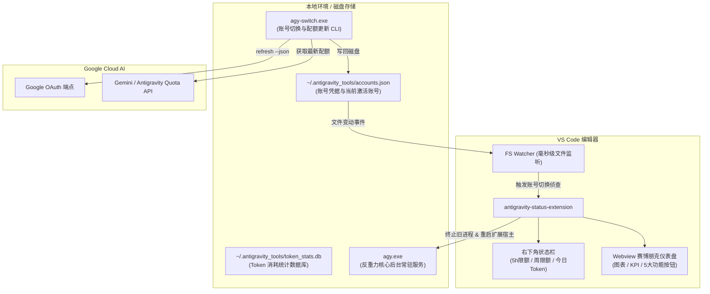

# Google Antigravity Status & Switcher 🚀

> 专为 **Google Antigravity**（反重力）打造的高性能 VS Code 状态监控、配额预警、多账号免关窗无感切换与高颜值仪表盘伴侣插件。

[](https://marketplace.visualstudio.com/)
[](https://github.com/)
[](https://www.typescriptlang.org/)
[](LICENSE)

---

## 💡 为什么需要本插件？（解决的三大核心痛点）

### 1. 外部切号后，VS Code 每次都必须关掉重新打开？
- **传统痛点**：使用外部切号软件（如 `AntiGravity Switch`、`agy-switch-desktop`）切换账号后，虽然磁盘上的配置更新了，但 VS Code 内存中常驻的后台核心进程 `agy.exe` 和 Extension Host 仍在持有旧账号的凭据与连接。导致开发者**每次切号都必须完全关闭 VS Code 再重新打开**，极其繁琐且打断编程心流。
- **本插件解决方案**：
  - **毫秒级底层文件监听 (FS Watcher)**：实时监测 `~/.antigravity_tools/accounts.json`。
  - **全自动热重载 (Zero-Restart)**：检测到切号事件时，自动终止旧的 `agy.exe` 核心进程，平滑重启扩展宿主（Extension Host），并自动唤醒反重力侧边栏面板。**全程 1 秒内无感完成，无需关闭 VS Code！**
  - **内置直接切号**：甚至不需要打开外部软件，直接在 VS Code 状态栏或仪表盘点击“👥 切换账号”，即可在账号池中快速选择并秒级生效。

### 2. 状态栏精准掌控 5小时配额与周配额
- **官方限制**：官方插件无法直观常驻查看配额，必须频繁点开侧边栏设置页查看。
- **本插件解决方案**：
  - **状态栏默认展示**：`✨ 反重力: 56% (5h) | 周 77% | 今日 259.3M`（5小时限额在前，周限额在后，数字与官方页面 100% 吻合对齐）。
  - **Gemini 4 独立额度显示**：当账号存在 Gemini 4 独立配额组时，状态栏自动追加 `G4 xx%/xx%`（5h/周），仪表盘与悬停浮窗中亦有独立明细卡片。
  - **低额度智能告警**：当 5小时限额 ≤ 20% 时状态栏变黄预警；≤ 5% 时变红告警。
  - **悬停浮窗 (Rich Tooltip)**：悬停即见当前登录邮箱、订阅等级、5h / 周周期限额明细表格、精确到分钟的重置倒计时（如 `4小时20分后 (2026-10-12 16:31)`）、生成速度（tokens/s）及首字延迟（TTFT）。

### 3. 高颜值赛博朋克深色仪表盘 (Cyberpunk Dashboard)
- 点击状态栏一键呼出独立的高级监控仪表盘：
  - **10 大核心 KPI 卡片**：今日总 Token、输入/输出 Token、缓存节省、调用次数、估算费用（自动读取 `api_pricing.json` 计算）、吞吐速度、首字延迟、当前账号等。
  - **24 小时 / 多日真实柱状图**：按统计范围展示真实的每小时（今天/昨天）或每日（近 3/7/30 天）Token 生成分布，数据来自本地统计而非估算。
  - **模型占比环形图**：直观展示不同模型的 Token 消耗与费用占比（真实 by_model 数据）。
  - **统计范围一键切换**：`今天 / 昨天 / 近 3 天 / 近 7 天 / 近 30 天` 按钮即点即切，KPI、图表与模型明细全部联动。
  - **模型级别明细表格**：模型名、费用、输入/输出详细分解。
  - **顶部 5 大直接功能按钮**（每个按钮均可直接点击生效，绝无多余摆设）：
    - `➕ 导入账号 (Token)`：通过 OAuth Refresh Token 快速导入新 Google 账号。
    - `👥 切换账号`：呼出账号池一键切换并自动生效。
    - `⚡ 热重启插件`：秒级平滑重启扩展宿主，恢复会话。
    - `🔌 冷重启核心`：强行结束并冷拉起 `agy.exe` 核心进程。
    - `🔄 刷新数据`：联动本地与云端实时拉取最新配额。

---

## 📸 功能特性一览

### 1. 状态栏与操作菜单
- **状态栏展示格式**：支持在设置中自定义 `standard`（5h配额 + 周配额 + 今日Token）、`5h-only`、`compact`、`full` 格式。
- **点击状态栏**：默认直接打开高级仪表盘（可在设置中切换为弹出管理快捷菜单）。
- **快捷菜单包含项**：
  - 📊 打开高级监控仪表盘
  - 🔄 刷新状态与配额数据
  - ➕ 导入账号 (OAuth Refresh Token)
  - 👥 切换反重力账号 (免重启 VS Code)
  - ⚡ 重新加载反重力插件 (Restart Extension Host)
  - 🔌 强制冷重启核心后端 (Kill & Restart `agy.exe`)
  - 🪟 重载 VS Code 窗口 (Reload Window)
  - ⚙️ 打开插件设置

### 2. 账号导入与 Google 授权登录（双模式支持）
- 在仪表盘或菜单点击 **“➕ 导入账号 (Token)”**，提供两种最便捷的方式：
  - 🌐 **浏览器跳转 Google 登录（一键授权 · 推荐）**：自动拉起系统浏览器打开 Google 官方授权页，在浏览器点击授权后，自动回调完成登录并同步凭据与配额，全程无需手动复制任何 Token！
  - 🔑 **直接填 Token / Refresh Token（免输邮箱）**：直接粘贴 `1//` 开头的 Refresh Token 或 Access Token，插件自动通过 Google OAuth 端点解析出对应 Google 邮箱与用户名并建立凭据，无需手动输入邮箱。
  - 📋 **粘贴完整 JSON 凭据**：支持直接粘贴包含 `refresh_token` 等信息的 JSON 文本自动导入。
- 导入成功后提示“是否立即切换至该账号”，点击即可瞬间切换使用。

---

## 🏗️ 架构与数据流图



---

## ⚙️ 配置项说明 (Configuration)

在 VS Code 设置中搜索 `antigravityStatus`，可进行个性化定制：

| 配置键名 | 类型 | 默认值 | 说明 |
| :--- | :---: | :---: | :--- |
| `antigravityStatus.statusBarClickAction` | `string` | `"dashboard"` | 点击状态栏的行为：`"dashboard"`（打开仪表盘）或 `"menu"`（弹出快捷菜单） |
| `antigravityStatus.autoReloadOnSwitch` | `boolean` | `true` | 当在外部软件切换账号时，是否自动重启核心进程并热重载 VS Code 插件使新账号立即生效（免手动关开 VS Code） |
| `antigravityStatus.displayFormat` | `string` | `"standard"` | 状态栏显示格式：`standard`（5h配额 + 周配额 + 今日Token）、`5h-only`、`compact`、`full` |
| `antigravityStatus.refreshIntervalSeconds` | `number` | `5` | 自动刷新间隔（秒），极低 CPU 开销（0.1ms 读取本地缓存） |
| `antigravityStatus.autoSyncOnlineOnTurn` | `boolean` | `true` | 当对话轮次完成时，是否在后台自动向 Google Cloud 校验最新配额 |
| `antigravityStatus.agySwitchPath` | `string` | `""` | `agy-switch` 可执行文件自定义路径。留空则自动检测主流安装位置 |

---

## 🚀 安装与使用

### 方式一：直接安装打包好的 VSIX（推荐）

1. 从 GitHub Releases 下载最新版本的 `antigravity-status-bar-1.5.0.vsix`；
2. 打开 VS Code，按下 `Ctrl + Shift + P`（macOS: `Cmd + Shift + P`）；
3. 输入并选择 **`Extensions: Install from VSIX...`**；
4. 选择下载的 `.vsix` 文件完成安装；
5. 右下角将立刻显示反重力状态栏！

### 方式二：源码构建与本地调试

```bash
# 1. 克隆本仓库
git clone https://github.com/HongChenGG/AntiGravity-Switch.git
cd AntiGravity-Switch

# 2. 安装依赖
npm install

# 3. 编译 TypeScript
npm run compile

# 4. 打包为 VSIX 安装包
npx @vscode/vsce package --no-git-tag-version --allow-missing-repository
```

---

## ❓ 常见问题 (FAQ)

### Q: 为什么读取配额完全不卡顿，且速度能达到 0ms？
> **A**: 插件采用三级缓存与就近读取架构：优先直接读取本地 `~/.antigravity_tools/accounts/` 与 `accounts.json`，纯磁盘 JSON 解析耗时仅 0.1ms；同时在生成轮次结束或点击刷新时，在后台通过子进程异步向云端同步，绝不阻塞 VS Code 界面或输入。

### Q: 外部切号软件已经切了，VS Code 里真的不需要关掉重开吗？
> **A**: 真的不需要！默认已开启 `autoReloadOnSwitch: true`。只要外部软件写入新账号，插件会在毫秒级捕获通知，自动终止后台旧进程并执行 `restartExtensionHost`，同时在启动时自动把反重力面板唤醒，整个过程无需任何手动干预。

### Q: 国内网络环境下云端配额刷新失败或超时怎么办？
> **A**: 插件内置了网络代理自适应机制，优先继承环境中的 `HTTP_PROXY`/`HTTPS_PROXY`（如 Clash 端口 `127.0.0.1:7897`），确保与 Google Cloud OAuth 端点的顺畅通信。

---

## 📄 开源许可 (License)

本项目基于 [MIT License](LICENSE) 许可开源。欢迎提交 Issue 与 Pull Request！
